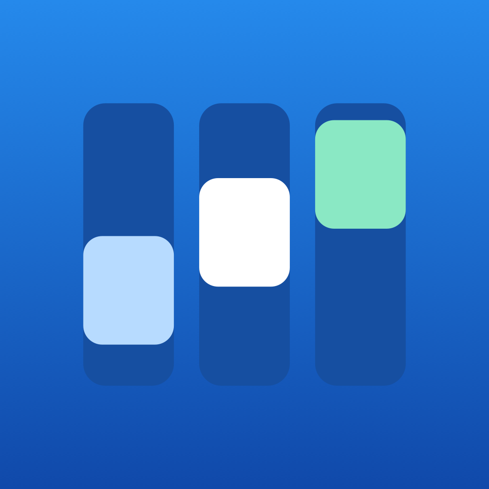
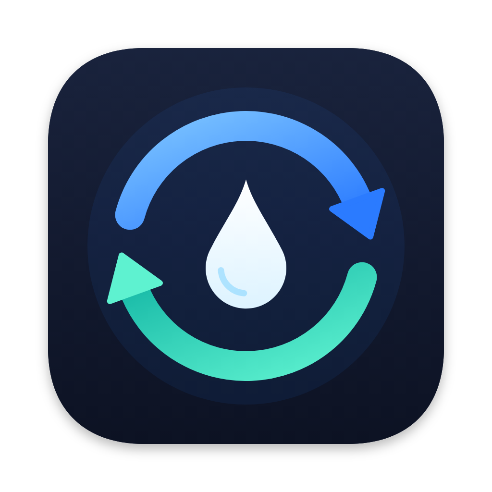
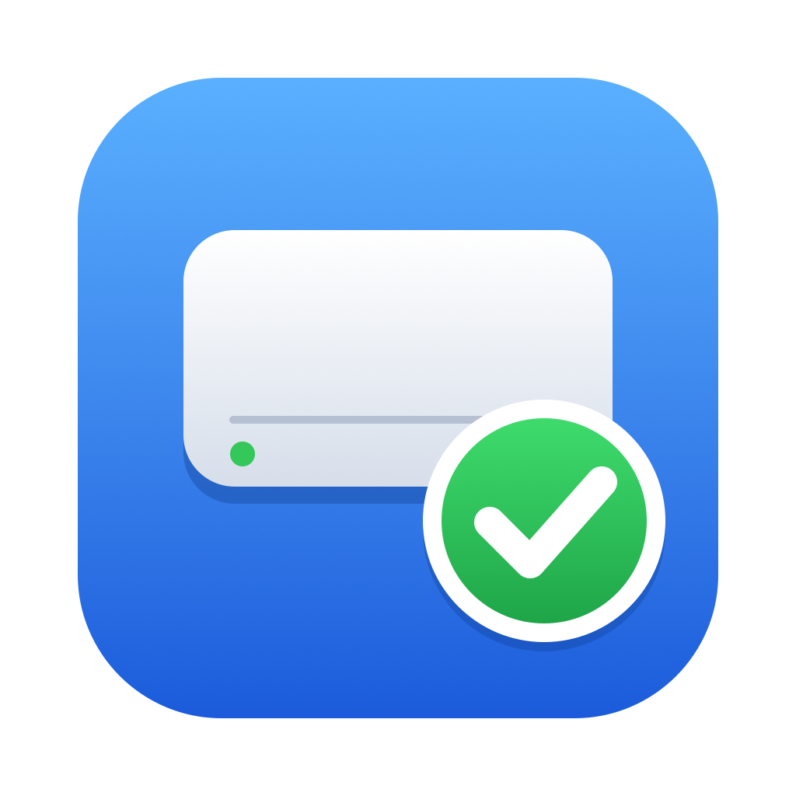
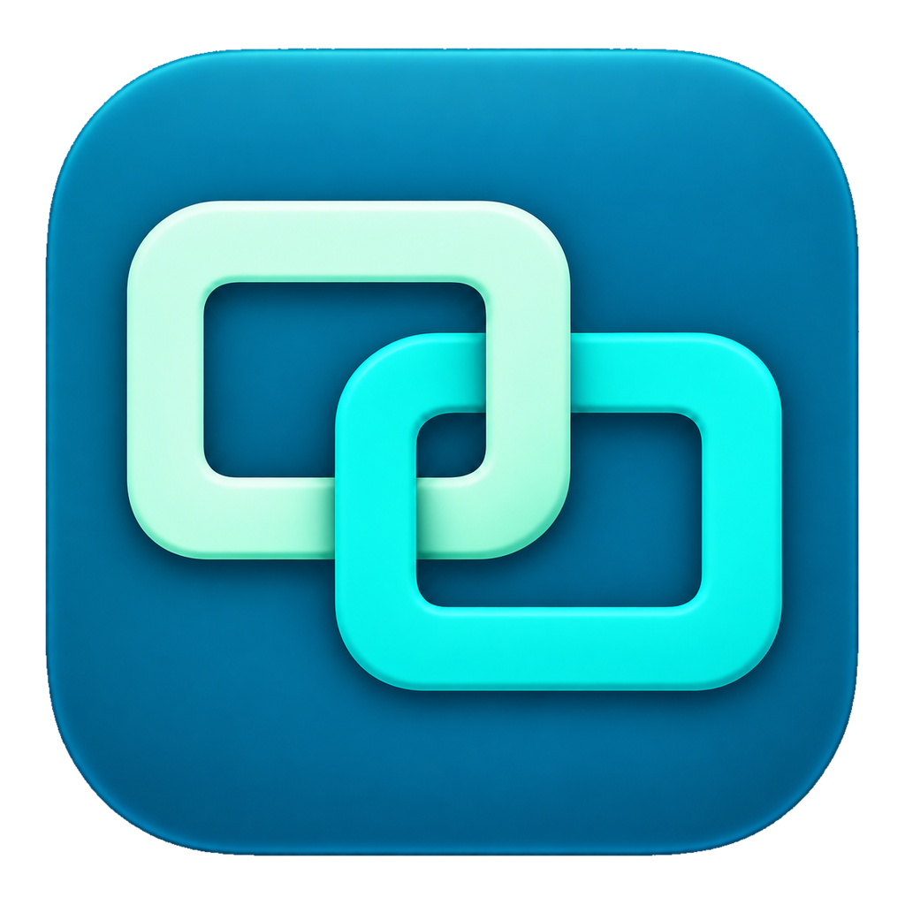

# Apps

アプリの紹介と、最新版の配布ページです。

---

## DevBoard

**AIとの開発を、ひとつのボードで。**

タスクを書いてAIに依頼し、作業の経過・質問・仕上がりをまとめて確認できるMacアプリです。複数のプロジェクトやタスクを並行して進められます。

macOS 15 以降

**[最新版をダウンロード（0.42.10）](https://github.com/ymasaki/public-releases/releases/download/local.masaki.DevBoard-0.42.10-1694/local.masaki.DevBoard-0.42.10-1694.zip)**

ZIP を開き、DevBoard.app を「アプリケーション」フォルダへ移してください。以降の新しい版はアプリ内でお知らせします。

<!-- dropsync:start -->
---

## DropSync

Dropbox と Mac のフォルダを同期するメニューバーアプリです。

macOS 14.0 以降（arm64）

**[最新版をダウンロード（0.1.0）](https://github.com/ymasaki/public-releases/releases/download/com.yamamoto.DropSync-0.1.0-83/com.yamamoto.DropSync-0.1.0-83.zip)**

ZIP を開き、DropSync.app を「アプリケーション」フォルダへ移してください。以降の更新はアプリ内でお知らせします。
<!-- dropsync:end -->

---

アプリを配布する方へ → [開発者向けガイド](DEVELOPERS.md)

<!-- app:local.autoaccept.mac:start -->
## AutoAccept

リムーバブルディスクへのアクセス確認を自動で許可するMacアプリです。

macOS 14.0 以降（arm64）

**[最新版をダウンロード（0.1.0）](https://github.com/ymasaki/public-releases/releases/download/local.autoaccept.mac-0.1.0-22/local.autoaccept.mac-0.1.0-22.zip)**
<!-- app:local.autoaccept.mac:end -->

<!-- app:local.remoteapps.mac:start -->
## RemoteApps

自分のMacのアプリや画面を別のMacから操作します。

macOS 15.0 以降（x86_64 / arm64）

**[最新版をダウンロード（0.45.2）](https://github.com/ymasaki/public-releases/releases/download/local.remoteapps.mac-0.45.2-167/local.remoteapps.mac-0.45.2-167.zip)**
<!-- app:local.remoteapps.mac:end -->
